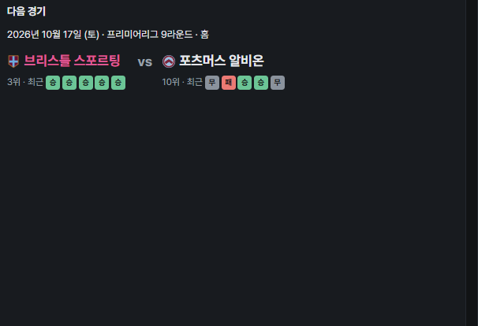
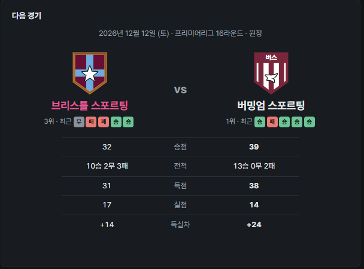
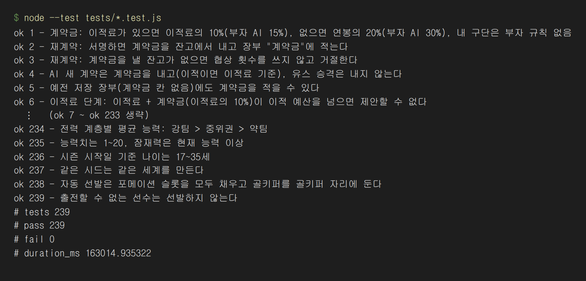
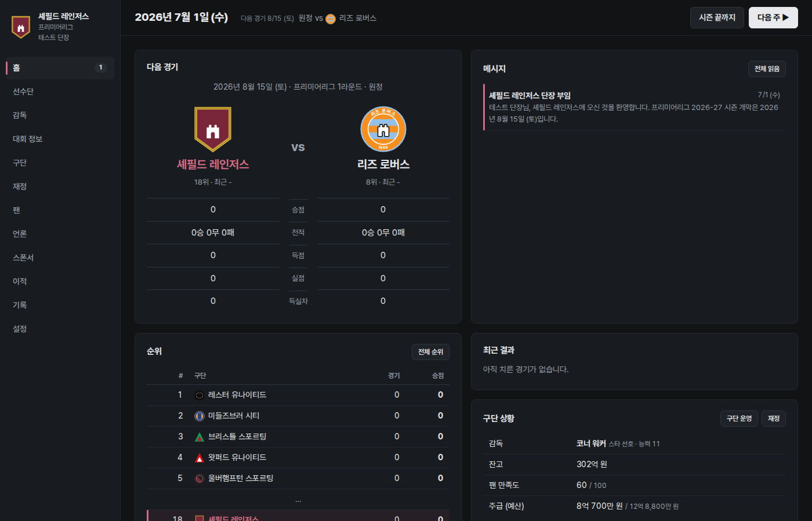
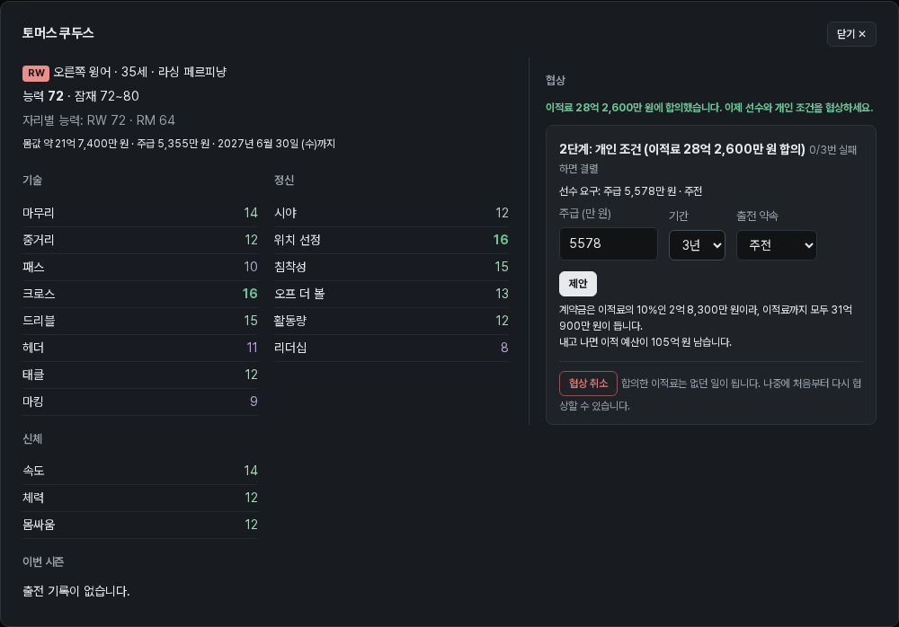
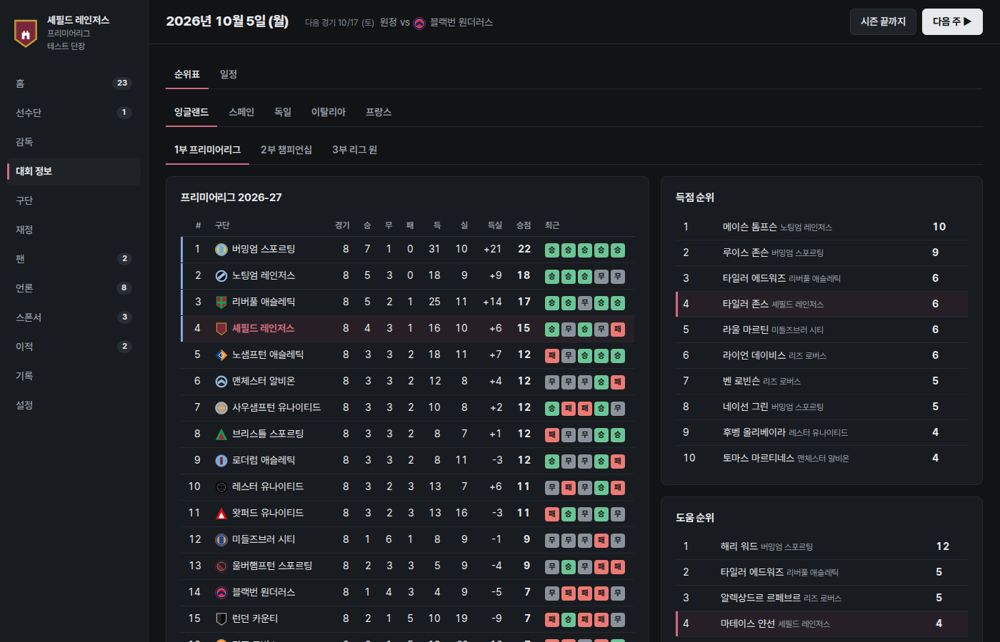

# 축구구단 키우기

브라우저에서 하는 축구 구단 경영 시뮬레이션. 플레이어는 감독이 아니라 **단장**이 되어 구단을 운영하고 키운다.

---

## 1. 프로젝트 목적 및 대상 사용자

### 목적
「축구구단 키우기」는 웹 브라우저에서 바로 하는 축구 구단 경영 시뮬레이션이다. 실제 유럽 리그 구조 위에 가상의 구단과 선수로 세계를 만들고, 플레이어는 한 구단의 **단장**이 되어 이적·계약·재정·시설·팬·스폰서를 관리하며 끝없이 시즌을 이어 간다. 경기와 전술은 고용한 AI 감독이 맡는다. 경기를 직접 조작하지 않고, 경영 판단의 결과를 시즌 단위로 확인하는 게임이다.

이 프로젝트에서 해 보려던 것은 AI 코딩 에이전트(Claude Code)와 여러 날에 걸쳐 협업해, 규칙이 서로 얽힌 경영 시뮬레이션을 끝까지 만들고 다듬는 일이다.

### 대상 사용자
- 구단을 운영하고 키워 나가는 재미를 즐기는 사람
- 축구를 좋아하지만 경기 전술까지 다루는 무거운 매니저 게임은 부담스러운 사람
- 구단 운영과 돈의 흐름(수입·지출·이적 시장)에 관심 있는 사람
- 설치 없이 브라우저에서 가볍게 하고 싶은 사람

---

## 2. 프로젝트 실행 및 사용 방법 가이드

### 필요한 것
Python 3(게임 서버), Node.js(테스트용, 22에서 확인. `node --test` 기능이 없는 18 미만 버전에서는 안 된다), 최신 웹 브라우저

### 실행
```bash
cd ~/workspaces/business-agent-lab/"Club building"
python3 tools/serve.py 8010
```
브라우저에서 `http://localhost:8010` 을 연다. (파일을 더블클릭해서는 실행되지 않는다.) `Address already in use` 오류가 나면 이미 8010번을 쓰는 서버가 있는 것이니, 그 서버를 끄거나 다른 번호(예: `python3 tools/serve.py 8020` → `http://localhost:8020`)를 쓴다.

### 테스트
```bash
cd ~/workspaces/business-agent-lab/"Club building"
node --test tests/*.test.js
```
게임 규칙(계약금, 예산, 경기, 화면 표시 등)이 맞게 동작하는지 자동으로 검사한다. 게임을 하는 데는 필요 없고, 코드를 고친 뒤 확인할 때 쓴다.

### 언론 AI 기능 (선택)
언론 탭의 기사와 팬 댓글을 AI로 쓰려면 프로젝트 폴더의 견본 파일 `.env.example`을 `.env`로 복사하고, 두 값을 채운 뒤 서버를 켠다.
```bash
cp .env.example .env
```
```
OPENROUTER_API_KEY=본인의 키
OPENROUTER_MODEL=모델 이름
```
API 키는 저장소에 들어 있지 않고, `.env`는 git에 올라가지 않는다. 서버가 키를 읽어 대신 요청을 보내므로 브라우저에는 키가 넘어가지 않는다. 키가 없어도 게임은 그대로 되고, 언론 탭에 기본 틀 기사가 나온다.

### 처음 하는 흐름
1. **새 게임**: 단장 이름을 넣고 **세계 생성**을 누른 뒤(시드를 넣으면 같은 세계), 나라·리그 탭에서 원하는 구단을 고른다. 가장 약한 구단에는 "도전" 표시가 붙는다.
2. **감독 확인**: 감독 탭에서 지금 감독과 팀 전술을 확인하고, 필요하면 교체한다.
3. **진행**: 위쪽 **다음 주 ▶** 버튼으로 날짜를 넘긴다. 결정할 일(이적 제안, 스폰서 제안 등)이 생기면 진행이 멈추고 해당 화면으로 간다.
4. **이적시장**: 여름(7~8월)과 겨울(1월)에 이적 탭에서 선수를 찾아 이적료 → 개인 조건 순서로 협상한다.
5. **시즌 준비**: 첫 홈 경기 전에 팬 탭에서 티켓 가격과 유니폼을 정한다.
6. **시즌 끝**: 정산과 승강을 확인하고 **다음 시즌 시작**을 누른다.

진행 상황은 브라우저에 자동 저장되고, 설정 탭에서 세이브 파일로 내보내거나 불러올 수 있다.

### 메뉴
| 메뉴 | 하는 일 |
|---|---|
| 홈 | 다음 경기, 메시지, 순위, 최근 결과, 구단 상황 |
| 선수단 | 1군·유스 선수 목록, 선수 정보, 재계약, 임대·이적 목록·등록·방출 |
| 감독 | 지금 감독(해고), 팀 전술, 선수단 진단과 추천 선수 요구, 감독 후보 고용 |
| 대회 정보 | 나라·리그별 순위표와 일정, 득점·도움 순위 |
| 구단 | 구단 정보, 시설 업그레이드, 스태프 수준 |
| 재정 | 잔고와 예산, 재정 조정 바, 주급, 시즌 장부, 시설 비용 |
| 팬 | 팬 만족도, 팬층, 티켓·시즌권 가격, 굿즈, 경기장 행사 |
| 언론 | 경기 기사와 팬 댓글, SNS·미디어 캠페인 |
| 스폰서 | 스폰서 계약·영업, 받은 제안, 경기장 대관, 프리시즌 투어 |
| 이적 | 감독 영입 요청, 받은 제안, 진행 중인 협상, 선수 찾기, 시즌 이적 기록 |
| 기록 | 단장 기록, 구단 역대 성적, 리그별 역대 우승 |
| 설정 | 언론 AI, 경기 보기, 진행 멈춤 조건, 저장·불러오기, 새 게임 |

### 화면별 설명
메뉴 이름을 누르면 그 화면의 카드·버튼·바 설명이 펼쳐진다. 결정이 필요한 것만 적었다.

<details>
<summary><b>위쪽 줄 (모든 화면 공통)</b></summary>

- **날짜와 다음 경기**: 오늘 날짜와 다음 우리 경기(날짜·홈/원정·상대).
- **다음 주 ▶**: 다음 월요일까지 진행한다. 경기 보기를 켜 두었으면 우리 경기 날 멈추고 경기 화면이 열린다.
- **시즌 끝까지**: 우리 경기도 결과만으로 처리하며 시즌 끝까지 진행한다. 결정할 일이 생기면 그날 멈춘다.
- **결정할 일 띠**: 진행이 멈추면 화면 위에 무엇을 정해야 하는지 보여 주고 해당 화면으로 이동한다(멈출 조건은 설정에서).
- **왼쪽 메뉴의 숫자**: 그 메뉴에서 아직 읽지 않은 메시지 수.

**세부 수치**

| 항목 | 수치 |
|---|---|
| 시즌 일정 | 7월 1일 시작(프리시즌, 이적시장 열림), 리그는 8월~5월. 잉글랜드 2·3부는 46라운드라 주중 경기가 있다. 프리시즌 친선 경기는 없다 |
| 다음 주 | 다음 월요일까지 진행 |
| 진행 멈춤 조건 | 감독 영입 요청, 내 선수 이적 제안, 스폰서 제안, 투어 선택, 대관 제안, 굿즈 품절 임박, 이적시장 열리기·마감 1주 전, 첫 리그 홈 경기 1주 전, 계약 만료 예정 재계약(1월·4월), 유스 입단 |
| 주간 요약 | 매주 월요일, 지난주 경기·순위·잔고 변화·팬 만족도를 메시지 하나로 묶는다 |
| 시즌 끝 처리 순서 | 기록 보관 → 승강·보관·복귀 → 은퇴 → 계약 만료 → 유스 정리 → AI 선수단 채우기 → 새 일정과 예산 |

</details>

<details>
<summary><b>홈</b></summary>

- **다음 경기**: 두 구단 로고와 이름 밑에 순위·최근 5경기(승·무·패), 아래에 승점·전적·득점·실점·득실차 비교(더 나은 쪽 굵게). 이번 시즌 이미 맞붙었으면 그 결과.
- **메시지**: 주간 요약, 감독 요청, 제안 등. 누르면 연결된 화면으로 간다. **전체 읽음**으로 읽음 처리.
- **순위**: 상위 5팀과 우리 구단. **전체 순위**는 대회 정보로 간다.
- **최근 결과**: 마지막 경기 점수. **경기 기록**으로 득점·카드·평점을 본다.
- **구단 상황**: 감독, 잔고, 팬 만족도, 주급(예산). **구단 운영**·**재정** 버튼으로 이동.

**세부 수치**

| 항목 | 수치 |
|---|---|
| 다음 경기 카드 | 두 팀의 순위와 최근 5경기, 승점·전적·득점·실점·득실차 비교 |
| 순위 카드 | 상위 5팀과 우리 구단 |

</details>

<details>
<summary><b>선수단</b></summary>

- **1군 / 유스 탭**: 유스(U-21 팀)는 아카데미에서 올라온 어린 선수들. 유스 탭에서 **1군 콜업**으로 올리고, 어린 1군 선수는 **내리기**로 U-21 팀에 보낸다.
- **정렬 버튼**: 선발순(감독이 다음 경기에 낼 선발 → 교체 → 나머지), 포지션순, 능력순, 나이순.
- **표 읽는 법**: 능력(지금 실력), 잠재(최대로 클 수 있는 실력), 컨디션 바(체력, 경기 뒤 줄고 쉬면 회복), 사기(낮으면 이적 요청). 계약 연도가 **빨간색**이면 지금 재계약할 수 있는 선수. 상태 표시: 이적 요청·이적 목록·임대·미등록·출전 정지·부상.
- **등록 인원**: 1군 등록 25명만 경기에 나갈 수 있고 전체는 30명까지. 등록 명단은 이적시장 기간에만 바꿀 수 있다.
- **선수를 누르면 (상세 창)**: 왼쪽에 능력치·이번 시즌·통산 기록, 오른쪽에 계약과 할 수 있는 일.
  - **재계약 협상**: 계약이 1년 이하로 남으면 주급·기간(1~5년)·출전 약속을 정해 **제안**. 한 달에 3번까지. 약속을 낮추면 주급을 더 원하고 높이면 덜 받는다. 아래 줄에 계약금(연봉의 20%, 잔고에서 냄)과 내고 남는 잔고가 입력할 때마다 바뀐다.
  - **임대 보내기**: 이적시장 중에만. 수준이 맞는 구단에서 시즌 끝까지 뛰고 돌아온다.
  - **이적 목록에 올리기**: 이적시장 동안 다른 구단 제안이 더 자주 온다(제안 금액은 조금 낮아짐).
  - **1군 등록 / 등록 해제**: 등록 25명 안에서 경기 명단을 고른다.
  - **계약 해지**: 남은 계약 기간 연봉의 절반을 위약금으로 내고 바로 내보낸다.

**세부 수치**

| 항목 | 수치 |
|---|---|
| 1군 등록 / 선수단 전체 | 25명 / 30명. 등록 명단은 이적시장 기간에만 바꾼다 |
| 25명을 넘을 때 자동 등록 | 골키퍼 2명, 자리마다 1명을 먼저 채우고 나머지는 능력 순. 이적시장 밖에서 영입하면 새 선수만 미등록 |
| 유스 예외 | 21세 이하이고 우리 유스에서 2년 이상 있었던 선수는 등록 없이 뛰고 인원에도 세지 않는다 |
| AI 구단 인원 | 유스 출신 포함 25명 유지(넘으면 약한 선수부터 방출). 외국인·홈그로운 규정은 없다 |
| 능력치 | 약 20개(기술·정신·신체), 각각 1~20. 종합 능력·잠재력·컨디션·사기·부상 |
| 성장 | 매달 계산. 나이·잠재력·출장 시간·훈련(훈련장·코치·감독)으로 오르고, 30대 초반부터 떨어지며 35세 전후 은퇴 |
| 훈련 | 중점 6가지(균형·공격·수비·체력·전술·세트피스)와 강도를 코치가 매주 정한다. 강도가 높으면 성장이 빠르지만 피로·부상이 는다 |
| 사기 | 0~100. 출전 시간, 비슷한 선수와의 주급 비교, 숙소 레벨(−8~+8), 팀 성적으로 매달 변한다. 경기력 0.97~1.02배. 25 아래인 달이 3번 이어지면 이적 요청, 45 이상으로 회복하면 거둔다 |
| 부상 | 경기 중 팀당 경기당 약 0.12건, 훈련 중에도 생긴다. 복귀 직후 컨디션 75 |
| 카드 징계 | 경고 2장 퇴장 → 1경기(누적에 안 셈), 다이렉트 레드 → 2경기, 경고 5장 누적 → 1경기. 시즌이 끝나면 초기화 |
| 유스 입단 | 3월 15일 구단마다 4~8명(15~16세), 가끔 황금 세대. 입단 능력 = 24 + 유스 아카데미 레벨 × 3, 잠재력 보정 = (유스 코치 − 10) × 0.8, 우리 구단은 +3 |
| U-21 팀 | 정원 14명. 시즌이 끝나면 21세가 넘었거나 정원을 넘는 유스는 방출 |
| 재계약 | 계약 1년 이하 남은 선수, 한 달 3번까지. 요구 주급은 능력 기준 주급의 1.1배(24세 이하이고 잠재력이 6 이상 남은 선수는 1.2배)이고, 30세 미만은 지금 주급의 1.05배 아래로는 요구하지 않는다. 두 값 모두 구단 키우기 보정(−10%)이 적용된다. 계약금 연봉(주급 × 52)의 20%, 잔고에서 낸다 |
| 계약 기간 | 1~5년, 만료되면 자유계약으로 떠난다 |
| 계약 해지 | 남은 계약 기간 연봉의 50%를 위약금으로 |
| 임대 보내기 | 이적시장 중에만, 수준이 맞는 AI 구단으로. 선수 능력이 받는 구단 수준 이상이면 그 구단이 주급 100%, 아니면 50%를 낸다(자동). 시즌 끝 복귀 |

</details>

<details>
<summary><b>감독</b></summary>

- **지금 감독**: 능력(1~20), 성향, 주급, 계약. **해고하기**는 남은 계약 기간 연봉의 절반을 위약금으로 내고, 새 감독을 뽑을 때까지 코치가 임시로 맡는다.
- **팀 전술**: 감독이 성향에 따라 정한 포메이션·성향·압박·템포·수비 라인. 단장은 보기만 한다. 경기 중 교체와 전술 변경도 감독이 한다.
- **선수단 진단**: 인원이 부족하거나 보강이 필요한 자리만 칸으로 보여 준다. 칸을 누르면 모든 자리의 인원·최고 능력·부상 수를 본다.
  - **추천 선수 요구**: 일주일에 한 번. 감독이 약한 자리부터 이적 예산 안에서 최대 3명을 골라 이적 탭 "영입 요청"에 올린다. 자유계약 선수도 포함.
- **감독 후보**: 능력이 높을수록 선수 성장과 경기 운영이 좋고 주급이 비싸다. 구단 평판보다 너무 뛰어난 감독은 "오지 않음". **2년 계약**은 지금 감독을 해고한 뒤에만 누를 수 있다.

**세부 수치**

| 항목 | 수치 |
|---|---|
| 감독 능력 | 1~20. 선수 성장에도 조금 반영된다 |
| 성향 5가지 | 공격형 4-3-3 높은 압박·빠른 템포 / 수비형 5-3-2 낮은 라인 / 유스 중시 4-3-3, 21세 이하 선발 가중 / 스타 선호 4-2-3-1, 상위 선수 가중 / 실리형 4-4-2, 상대가 강하면 4-5-1·약하면 4-3-3 |
| 경기 중 판단 | 지고 있으면 공격적으로, 1점 앞선 80분부터 수비적으로 |
| 감독 후보 / 계약 | 6명 / 2년. 구단 평판보다 너무 뛰어난 감독은 오지 않는다 |
| 해고 위약금 | 남은 계약 기간 연봉의 50%. 빈자리 동안은 코치가 임시로 맡는다 |
| 영입 요청 | 이적시장마다 약한 자리(인원 부족 먼저)에 2~4명 |
| 선수단 진단 기준 | "보강 필요" = 그 자리 최고 능력이 주전 평균보다 4 넘게 낮음 |
| 추천 선수 요구 | 일주일에 한 번, 이적 예산 안에서 최대 3명(비슷하면 자유계약 우선). 시장이 닫혀 있으면 다음 시장 마감까지 유효 |

</details>

<details>
<summary><b>대회 정보</b></summary>

- **순위표 / 일정 탭**, 그 아래 **나라 탭**(잉글랜드·스페인·독일·이탈리아·프랑스)과 **리그 탭**(1~3부): 다른 나라·리그도 볼 수 있다.
- **순위표**: 왼쪽 색 막대는 1부 상위 4팀(파랑), 2·3부 승격권, 강등권(빨강). 우리 구단 줄은 구단 색으로 강조.
- **득점·도움 순위**: 리그 상위 10명. 우리 선수 줄은 강조.
- **일정**: 라운드를 골라 그 라운드 경기와 결과를 본다. 끝난 경기를 누르면 경기 기록(득점·카드·평점).

**세부 수치**

| 항목 | 수치 |
|---|---|
| 리그 | 5개 나라 × 1~3부, 302개 구단. 잉글랜드 20·24·24, 독일 18·18·20, 스페인 20·22·20, 이탈리아 20·20·20, 프랑스 18·18·20 |
| 승강 | 부 사이마다 3팀씩. 4부는 없고, 3부 하위 3팀은 보관(경기 없음, 기록 유지) |
| 보관 구단 복귀 | 강등된 지 2시즌 이상 지난 보관 구단이 30% 확률로 3부 빈자리에 돌아오고, 아니면 새 구단을 만든다 |
| 이적시장 | 여름 7/1~8/31, 겨울 1/1~1/31. 그 밖에는 자유계약 선수만 영입 |
| 경기 밸런스 (2026-11-01, 2000경기 측정) | 경기당 골 2.93, 홈 승 47.8% / 무 21.4% / 원정 30.8%, 경고 3.64장, 퇴장 0.10회, 페널티킥 0.33개(성공률 76.5%) |
| 강팀 승률 (측정) | 주전 평균 능력이 7 이상 차이 나면 80.6%(500경기) |
| 시즌 밸런스 (2026-11-01, 5시즌 측정) | 우승 승점 76~96, 꼴찌 18~28, 득점왕 23~46골 |

</details>

<details>
<summary><b>구단</b></summary>

- **구단 정보**: 연고지, 구단 평판, 경기장 좌석과 예상 관중 비율, 순위, 잔고.
- **시설**: 8개 시설(경기장·훈련장·유스 아카데미·의료 시설·수영장·회복 센터·스포츠 과학 센터·선수 숙소·메가스토어)의 레벨(별 1~5)과 효과.
  - **업그레이드**: 버튼 옆에 공사비와 기간. 공사비는 시작할 때 한 번에 나가고, 레벨이 높을수록 매달 유지비가 는다. 경기장 증축 중에는 수용 인원이 20% 줄어든다.
- **스태프**: 코치·스카우트·의료진·유스 코치·마케팅 담당의 수준(1~20). **− / +** 로 바꾸면 주급이 바뀌고(올리면 얼마 느는지 표시), 주급 예산 안에서만 올릴 수 있다.
  - 스카우트가 높으면 다른 구단 선수 잠재력이 좁은 범위로 보이고, 마케팅 담당이 높으면 티켓 예상 관중·수입 범위가 정확해진다.

**세부 수치**

| 항목 | 수치 |
|---|---|
| 레벨 | 시설 1~5, 스태프 1~20 |
| 일반 시설 업그레이드 | 1→2 15억, 2→3 40억, 3→4 90억, 4→5 180억 |
| 경기장 업그레이드 | 1→2 60억, 2→3 150억, 3→4 350억, 4→5 700억. 증축 중 수용 인원 20% 감소 |
| 유스 아카데미 · 유스 코치 | 다른 시설·스태프의 절반 값(7.5억, 20억, 45억, 90억) |
| 공사 기간 | 일반 시설 1→2 3개월, 2→3 4개월, 3→4 5개월, 4→5 6개월 / 경기장 8·10·12·14개월 |
| 시설 유지비 (한 달, 시설 하나) | 레벨 1 약 600만, 2 약 1,320만, 3 약 2,900만, 4 약 6,390만, 5 약 1억 4,000만 원. 유스 아카데미는 절반 |
| 시설 효과 | 경기장 → 입장 수입 / 훈련장 → 성장 속도 / 유스 아카데미 → 유스 입단 능력 / 의료 시설 → 부상 회복 / 수영장·회복 센터 → 경기 후 체력 회복 / 스포츠 과학 센터 → 부상 확률 감소 / 선수 숙소 → 사기 / 메가스토어 → 관중 비율·티켓값 |
| 스태프 효과 | 코치 → 성장·주간 훈련 / 스카우트 → 잠재력 범위 정확도 / 의료진 → 부상 확률·회복 / 유스 코치 → 유스 잠재력 / 마케팅 담당 → 예상 관중·판매 범위 정확도 |
| 스카우트 정확도 | 다른 구단 선수 잠재력 범위: 1수준 ±10 ~ 20수준 ±1 |
| 마케팅 정확도 | 예상 관중 범위: 1수준 ±25% ~ 20수준 ±3% |
| 평판 보정 (우리 구단) | 기대 순위보다 3계단 이상 잘하면 평판 +1, 8계단 이상이면 +2 |

</details>

<details>
<summary><b>재정</b></summary>

- **잔고와 예산**: 잔고(큰 숫자), 이적 예산(영입·계약금에 쓰는 돈, 잔고 안에 따로 떼어 둔 돈), 주급 예산(주), 남은 주급 여유, **시설·행사에 쓸 수 있는 돈**.
  - 시설·행사 비용이 바로 쓸 수 있는 돈을 넘으면, 확인을 받고 나머지를 이적 예산에서 꺼낸다.
- **재정 조정 바**: 이적 예산과 주급 예산을 맞바꾼다. 왼쪽으로 밀면 줄인 주급만큼 이적 예산이 늘고, 오른쪽으로 밀면 이적 예산을 주급 예산으로 옮긴다. 끄는 동안 숫자가 함께 바뀐다. 주급 예산은 지금 주급 아래로 내릴 수 없다.
- **주급**: 선수·스태프·감독 주급 합계와 주급 상위 선수.
- **이번 시즌 장부**: 항목별 수입(중계권·순위 상금·입장·스폰서·굿즈·대관·선수 판매)과 지출(주급·유지비·공사·굿즈 생산·행사·영입·계약금), 수지.
- **시설 비용**: 시설별 유지비와 다음 업그레이드 비용. "가능"은 바로 쓸 수 있는 돈으로, "이적 예산 사용"은 이적 예산에서 꺼내야, "부족"은 돈이 모자란다는 뜻. **구단 탭에서 업그레이드**로 이동.
- **지난 시즌**: 지난 시즌 수입·지출 요약.

**세부 수치**

| 항목 | 수치 |
|---|---|
| 통화 | 원(₩), €1 = 1,500원으로 실제 규모를 환산 |
| 수입 | 중계권, 입장, 스폰서, 굿즈, 대관, 투어 초청료, 이적료 |
| 지출 | 선수 주급, 스태프·감독 주급, 시설 유지비, 공사비, 굿즈 생산, 행사·SNS, 이적료, 계약금 |
| 중계권 | 절반은 매달 똑같이, 절반은 시즌 끝 순위 상금(1위 1.5배 ~ 꼴찌 0.5배) |
| 정산 | 매달 마지막 날. 시즌 장부와 지난 5시즌 기록을 남긴다 |
| 주급 예산 | 예상 수입의 70% 또는 지금 주급의 1.1배 중 큰 값 |
| 이적 예산 | 첫 시즌 잔고의 45%. 이후 남은 이적 예산 + 지난 시즌 수익(이적 거래·시설 공사비 제외)의 50%(적자면 50% 차감), 잔고의 20% 아래로는 안 내려간다 |
| 선수 판매 | 판 돈이 이적 예산에 더해진다(잔고가 마이너스면 빚부터 갚고) |
| 재정 조정 바 | 왼쪽: 줄인 주급 × 남은 주만큼 이적 예산 증가(주급 예산은 지금 주급 아래로 못 내림). 오른쪽: 이적 예산을 주급 예산으로, 0이 되면 남는 잔고로 더(최대 = 시즌 시작 주급 예산 + 잔고 ÷ 남은 주) |
| 시설·행사에 쓸 수 있는 돈 | 잔고 − 이적 예산 − 시즌 시작보다 올린 주급 × 남은 주. 모자라면 확인을 받고 나머지를 이적 예산에서 꺼낸다 |
| 잔고 마이너스 | 허용, 파산은 없다. 마이너스인 동안 팬 만족도가 떨어진다 |
| 강등 보조금 | 두 시즌 동안 떠난 리그 중계권료의 50%, 25%(승격하면 끊김) |
| 구단 키우기 보정 | 직접 버는 수입(입장·스폰서·굿즈·대관) +10%, 선수 주급 요구 −10%. 중계권·상금은 그대로 |

</details>

<details>
<summary><b>팬</b></summary>

- **팬 만족도 (0~100)**: 기대 순위보다 잘하면 오르고 못하면 내린다. 30 아래로 떨어지면 팬이 항의하고 관중이 줄어든다.
- **팬층**: 충성층·유행층·가족층·지역층 비율과 만족도. 충성층은 성적, 유행층은 스타 영입(능력 75 이상)과 다득점, 지역층은 유스 출신 출전, 가족층은 티켓값에 반응한다. 해외 팬 수(투어로 늘고 스폰서 금액·굿즈 판매를 키움)와 라이벌 구단.
- **티켓 (바 4개)**: 시즌권·보통·빅매치·라이벌전 가격. 바를 밀면 옆의 예상 관중과 경기당 수입 범위가 바로 바뀐다.
  - 시즌권은 첫 홈 경기 날 판매가 확정되고, 그 좌석은 매 홈 경기 먼저 채워진다. 빅매치는 평판이 5 이상 높은 상대나 리그 상위 4팀, 라이벌전은 라이벌과의 경기.
- **가격 기록**: 홈 경기마다 가격·관중·만족도.
- **굿즈**: 홈·원정 유니폼, 머플러, 아동용품 등의 가격·재고·판매·시즌 예상 판매. **품목을 누르면** 디자인(클래식·모던·레트로·스타 마킹)·가격·수량을 정해 생산한다.
  - 팬층마다 좋아하는 디자인이 다르다(충성층은 클래식·레트로, 유행층은 모던·스타 마킹 등).
  - 유니폼은 시즌에 한 번 생산하고 한 번 추가 생산할 수 있다(원가 1.3배, 30일 뒤 도착). 첫 홈 경기까지 정하지 않으면 지난 디자인으로 자동 생산한다.
- **경기장 행사**: 남은 홈 경기마다 **행사 열기**로 행사를 고른다. 그 경기 관중과 팬층 만족도가 오르고, 비용은 예약할 때 나간다. 최근 4번 안에 같은 행사를 또 열면 효과가 반씩 준다.

**세부 수치**

| 항목 | 수치 |
|---|---|
| 팬층 | 충성층·유행층·가족층·지역층. 평판이 높을수록 유행층, 낮을수록 지역층·충성층 |
| 만족도 | 0~100, 시작 60. 매달 60과의 차이 10%만큼 자연 회복, 새 시즌에는 60 쪽으로 33% 돌아간다 |
| 만족도 효과 | 관중 비율과 상업 수입을 최대 ±10%. 30 아래면 항의 메시지와 매달 관중 2%씩 추가 감소(최대 10%) |
| 해외 팬 | 처음보다 늘어난 비율의 15%만큼 스폰서 금액·굿즈 판매 증가(최대 1.25배) |
| 티켓 등급 | 보통 1× / 빅매치 1.4×(평판 5 이상 높은 상대나 리그 상위 4팀) / 라이벌전 1.6×(같은 도시 구단, 없으면 평판이 가장 비슷한 구단) |
| 가격 범위 | 등급마다 기본 가격의 50~200%. 평균 가격이 10% 넘게 비싸면 가족층·지역층 만족도 하락, 싸면 상승 |
| 가격 민감도 | 가족층 > 지역층 > 유행층 > 충성층 |
| 시즌권 | 일반 티켓 × 홈 경기 수 × 75%. 첫 리그 홈 경기 날 판매 확정, 좌석의 최대 70% |
| 가격 기록 | 최근 20경기 |
| 상업 수입 나눔 | 굿즈 30%, 스폰서 70%(AI 구단은 상업 수입 하나) |
| 유니폼 | 디자인 4가지(클래식·모던·레트로·스타 마킹). 시즌에 한 번 생산, 추가 생산 한 번(원가 1.3배, 30일 뒤 도착) |
| 스타 마킹 | 능력 75 이상 선수가 없으면 효과가 약하고, 마킹 선수가 떠나면 판매 크게 감소 |
| 기타 굿즈 | 머플러(충성층)·아동용품(가족층)은 언제든 주문, 14일 뒤 도착. 한정판은 우승·승격 때만 30일 안에 주문 |
| 남은 재고 | 시즌 끝 원가 30%에 정리 |
| 경기장 행사 | 하프타임 공연·팬 데이·레전드 경기. 그 경기 일반 티켓 수요 +3% / +5% / +8%. 최근 4번 안에 같은 행사면 효과 절반, 취소하면 절반 환불 |

</details>

<details>
<summary><b>언론</b></summary>

- **기사**: 우리 경기가 끝나면 기사와 팬 댓글이 실린다. 경기 없는 주에는 이적·투어 같은 큰일이 있으면 월요일에 실린다. 제목 옆에 AI 연결 상태(연결됨 / 키 없음 / 오류 / 서버 없음 / 꺼짐).
- **SNS·미디어**: 선수 Q&A, 숏폼, 지역 방송, 유튜브 시리즈, 구단 다큐멘터리 같은 캠페인을 **시작**한다. 표에 기간·해외 팬 증가·팬층 반응·선수 피로·비용이 나온다.
  - 동시에 2개까지. 효과는 운에 따라 0.6~1.4배이고, 1년 안에 같은 캠페인을 다시 하면 60%로 준다. 능력이 높은 선수부터 참여해 체력이 조금 떨어진다.

**세부 수치**

| 항목 | 수치 |
|---|---|
| 기사가 실리는 때 | 우리 경기가 끝날 때마다 한 편. 경기 없는 주에 이적·투어 같은 큰일이 있으면 월요일에 한 편 |
| 기사 보관 | 최근 30편 |
| 기사 내용 | 경기 결과·득점자·순위 변화, 영입·판매, 2주 넘는 부상, 티켓값·시설·스태프 변경, 캠페인·행사·투어, 라이벌 결과 한 줄 |
| 댓글 | 기사마다 6개, 팬층 비율대로 나눈다 |
| SNS 캠페인 | 동시에 2개까지. 비용은 평판 비례 |
| 캠페인 종류 (기간 · 해외 팬 증가 · 참여 선수) | 선수 라이브 Q&A 7일 · +1% · 2명 / 숏폼 챌린지 14일 · +2% · 3명 / 지역 방송 출연 14일 · 0% · 2명 / 유튜브 시리즈 30일 · +4% · 4명 / 구단 다큐멘터리 60일 · +8% · 6명 |
| 캠페인 효과 | 운에 따라 0.6~1.4배, 1년 안에 같은 캠페인을 다시 하면 60%. 참여 선수는 조금 지친다 |

</details>

<details>
<summary><b>스폰서</b></summary>

- **스폰서 계약**: 자리 7개(유니폼 가슴·경기장 이름·소매·훈련장·공식 파트너 3)의 회사·연 금액·계약 끝·성적 보너스.
  - **영업**: 빈자리나 1년 안에 끝나는 자리에서 업종을 골라 영업하면 1~2주 뒤 1~3곳이 제안한다. 금액은 리그·평판·성적·팬 만족도·해외 팬으로 정해지고, 업종마다 팬층 반응이 다르다.
- **받은 제안**: 수락하거나 금액을 올려 다시 요구한다. 너무 높거나 세 번째 요구면 결렬될 수 있다.
- **경기장 대관**: 매달 1일에 대관 제안이 온다. 받으면 돈이 들어오지만 잔디가 상한다. 잔디는 하루 1씩 회복하고, 상해 있는 동안 홈 경기 전력이 조금 떨어진다(6~7월 대관은 손상 절반). **잔디 보호 시스템**을 지으면 대관 때 잔디를 보호한다.
- **프리시즌 투어**: 정해진 날까지 국내·유럽·아시아·북미·중동 가운데 하나를 **선택**하거나 **가지 않음**. 멀리 갈수록 초청료와 해외 팬이 늘지만 피로와 부상 위험도 커진다. 주전 선수의 나라로 가면 해외 팬이 더 늘어난다.

**세부 수치**

| 항목 | 수치 |
|---|---|
| 자리 7개 비중 | 유니폼 가슴 35%, 경기장 이름 25%, 소매 12%, 훈련장 10%, 공식 파트너 6% × 3 |
| 업종 6개 | 베팅 1.4배(가족층·지역층 불만) / 금융·항공 1.15배 / 자동차·전자(유행층 호감) / 스포츠 브랜드(유행층·충성층 호감) / 식음료 0.85배(가족층 호감) / 지역 기업 0.7배(지역층 크게 호감) |
| 영업 | 빈자리나 1년 안에 끝나는 자리에서. 7~14일 뒤 1~3곳 제안(기간 1~5년, 순위 목표 보너스), 14일 안에 답 |
| 금액 올려 요구 | 3번째거나 너무 높으면 결렬 |
| 금액 계산 | 기준 × 성적(기대 순위 대비) × 만족도(최소 0.6배) × 해외 팬 |
| 프리시즌 투어 | 7월 1~15일에 국내·유럽·아시아·북미·중동 중 선택하거나 가지 않음. 7월 31일 반영 |
| 투어 지역 (초청료 배수 · 해외 팬 증가 · 피로) | 국내 0.3 · +2% · 3 / 유럽 1 · +8% · 6 / 아시아 2 · +20% · 12 / 북미 2 · +20% · 12 / 중동 2.5 · +10% · 7. 초청료는 평판 비례 |
| 투어 주전 보너스 | 그 지역 나라 주전이 있으면 한 명당 해외 팬 증가 +50%(최대 2명, +100%) |
| 대관 제안 | 매달 1일 0~2건(5~8월 +1), 14일 안에 답. 홈 경기 앞뒤 하루는 대관 불가 |
| 대관 종류 (좌석당 대관료 · 잔디 손상) | 음악 페스티벌 €11 · 40 / 콘서트 €8 · 30 / 다른 종목 경기 €6 · 25 / 박람회·전시 €3 · 12 / 기업 행사 €2 · 6 |
| 잔디 | 대관하면 손상(6~7월은 절반), 하루 1씩 회복. 손상만큼 홈 경기 전력이 준다 |
| 잔디 보호 시스템 | 경기장 3레벨 이상, 225억 원·8개월. 완공되면 잔디 손상 없음, 대관료 +20%, 제안 +1 |

</details>

<details>
<summary><b>이적</b></summary>

- **맨 위 줄**: 이적시장 열림/닫힘과 마감일, 이적 예산·주급 여유·1군 등록 인원. **재정 조정**으로 재정 조정 바를 연다.
- **감독의 영입 요청**: 감독이 추천한 선수. **승인**하면 "진행 중인 협상"에 올라가고, **거절**하면 지운다.
- **받은 제안**: 다른 구단이 우리 선수에게 낸 이적료. **수락 / 거절 / 역제안**(금액 입력, 한 번만, 너무 높으면 상대가 거둠). 선수를 누르면 감독의 의견(성장 가능성·팀 내 역할·팔지 말지)을 본다.
- **진행 중인 협상**: 협상 중인 선수와 단계(이적료 협상 중 / 이적료 합의·개인 조건 협상 / 결렬).
- **선수 찾기**: 포지션·리그·나이·몸값·자유계약만으로 검색. **접기**를 누르면 결과 표만 숨는다. 다른 구단 선수의 잠재력은 스카우트 수준에 따라 범위로 보인다.
- **선수를 누르면 (협상 창)**:
  1. **이적료**: 금액을 넣고 **제안**. 낮으면 상대 구단이 원하는 금액을 알려 준다. 3번 실패하면 그 이적시장에서는 결렬.
  2. **개인 조건**: 주급·기간·출전 약속을 넣고 **제안**. 3번 실패하면 결렬.
  - 입력 칸 아래 줄에 계약금(이적료의 10%, 자유계약은 연봉의 20%)과 이적료 + 계약금이 이적 예산에서 얼마 남거나 모자란지 바로 보인다.
  - **협상 취소**: 진행 중인 협상을 그만둔다. 합의한 이적료는 없던 일이 되고, 나중에 처음부터 다시 협상할 수 있다(결렬된 협상은 취소 불가).
  - 자유계약 선수는 이적료 없이 개인 조건부터 시작하고, 이적시장이 닫혀 있어도 계약할 수 있다.
- **이적 목록·이적 요청 / 임대 보낸 선수**: 해당 선수가 있을 때만 나온다.
- **시즌 이적 기록**: 우리 구단 / 우리 리그 / 전체, 시즌 선택. 날짜별 이적과 우리 구단의 지출·수입.

**세부 수치**

| 항목 | 수치 |
|---|---|
| 보이는 정보 | 다른 구단 선수는 종합 능력·자리별 능력·나이·몸값·주급·계약·부상. 잠재력은 스카우트 수준에 따른 범위(1수준 ±10 ~ 20수준 ±1) |
| 몸값 예 | 능력 85 ≈ 1,400억, 75 ≈ 230억, 65 ≈ 40억, 55 ≈ 6억 원. 어린 선수는 잠재력, 30세 이상은 나이, 계약 1년 미만은 남은 기간 반영 |
| 이적료 기준 | 몸값 × 주전 1.3 / 로테이션 1.1 / 백업 0.9. 이적 요청 선수 0.8배, 마감 3일 전 0.9배 |
| 협상 기회 | 이적료 3번 실패하면 그 시장에서 결렬, 개인 조건도 3번 실패하면 결렬 |
| 선수 거절 | 우리 평판이 15 넘게 낮으면 선수가 거절 |
| 계약금 | 이적료가 있으면 이적료의 10%, 자유계약은 연봉(주급 × 52)의 20%. 이적료 + 계약금이 이적 예산 안이어야 한다 |
| 주급 요구 | 능력 기준 주급(능력별 기준 × 우리 선수단 주급 수준(0.5~1.5)의 제곱근)의 1.07배와 지금 주급의 95% 중 큰 값. 우리 구단은 앞의 값에 −10% 보정 |
| 출전 약속 | 요구보다 낮추면 단계당 15% 더 원하고, 높여 주면 단계당 8% 덜 받는다 |
| 수락 기준 | 요구 주급의 95% 이상 |
| 지급 | 이적료는 한 번에. 분할·옵션·셀온은 없다 |
| 받은 제안 | 이적시장 동안 매일 확률(기본 2%, 이적 목록·이적 요청 선수 한 명마다 +4%, 최대 30%), 몸값 0.8~1.05배. 역제안은 한 번, 1.2배까지. 7일 안에 답하지 않으면 거절 |
| 자유계약 | 계약이 끝난 선수는 1년 동안 자유계약으로 남고, 이적시장과 상관없이 개인 조건만으로 영입 |
| 임대 데려오기 | 주전 아닌 선수, 주급 75~100% 부담, 완전 이적 옵션 몸값 × 1.1. 시즌 끝 복귀 |
| AI 구단 이적 | 여름 구단당 최대 3명·겨울 1명. 부자 AI 구단(잔고 > 예상 시즌 수입 1.5배)은 여름 5명·겨울 2명, 계약금 이적료의 15%·연봉의 30% |

</details>

<details>
<summary><b>기록</b></summary>

- **단장 기록**: 단장으로 보낸 시즌마다 맡은 구단·리그·순위. 첫 시즌이 끝나면 쌓인다.
- **구단 역대 성적**: 우리 구단의 시즌별 리그·순위·승점.
- **역대 우승**: 나라·리그 탭별로 시즌마다 우승·준우승 구단과 득점왕.

**세부 수치**

| 항목 | 수치 |
|---|---|
| 경기 세부 기록 | 지난 시즌까지만 보관(그 전 시즌은 결과만) |
| 재정 기록 | 시즌 장부와 지난 5시즌 |

</details>

<details>
<summary><b>설정</b></summary>

- **기사·댓글 AI**: 체크하면 언론 기사와 팬 댓글을 AI로 쓴다. 아래에 연결 상태. 하루 사용 제한에 걸리면 여기서 끈다(끄면 기본 틀 기사).
- **구단 키우기 보정**: 단장 구단에만 붙는 보정(직접 버는 수입 +10%, 선수 주급 요구 −10%, 기대 이상 성적이면 평판 추가 상승, 유스 잠재력 +3). 보기만 한다.
- **경기 보기**: 우리 경기를 결과만 / 하이라이트 / 전체 중계 중에서 고른다. 하이라이트·전체 중계는 체크한 순간(하프타임, 실점 직후, 퇴장, 60분에 지고 있을 때 등)에 멈춘다.
- **진행 멈춤**: "다음 주"·"시즌 끝까지"로 진행할 때 체크한 일(이적 제안, 감독 영입 요청, 이적시장 열림·마감 1주 전, 첫 홈 경기 1주 전, 재계약, 유스 입단, 투어 선택, 스폰서·대관 제안, 굿즈 품절 임박)이 생기면 그날 멈추고 그 화면으로 간다. 끄면 메시지만 남는다.
- **저장**: 진행은 브라우저에 자동 저장된다. **세이브 파일 내보내기 / 불러오기**로 백업하거나 다른 기기에서 이어 한다. **새 게임 시작**은 지금 진행을 지운다.

**세부 수치**

| 항목 | 수치 |
|---|---|
| 구단 키우기 보정 | 단장 구단에만: 직접 버는 수입 +10%, 선수 주급 요구 −10%, 기대 순위보다 3계단 이상 잘하면 평판 +1(8계단 이상 +2), 유스 잠재력 +3 |
| 언론 AI | 기본 켜짐. 무료 모델은 하루 요청 수 제한이 있어 넘으면 틀 기사가 나온다 |

</details>

---

## 3. 작업 프로세스

AI 코딩 에이전트(Claude Code)와 대화하며 아래 순서를 반복했다.

1. **설계 문서부터 쓰고 단계별로 만들기**: 설계 문서를 먼저 쓰고, 기반(시드 난수·세계 생성·경기 엔진) → 리그와 시즌 → 재정·이적·훈련 → 팬·스폰서·언론 순서로 쌓았다. 단계마다 커밋하고 확인했다.
2. **질문 라운드로 계획 정하기**: 구현 전에 AI가 정해야 할 것을 한 번에 최대 4개씩, 추천안과 함께 묻고 사용자가 답해 확정했다. 이 과정에서 게임 방향을 "플레이어 = 감독"에서 "플레이어 = 단장(재정 중심)"으로 바꿨다.
3. **화면은 시안을 비교해서 결정**: 정하기 어려운 화면은 프로토타입 브랜치에 시안 여러 개를 만들어 직접 보고 골랐다(상세 화면 방식, 재정 카드, 구단 로고).
4. **숫자는 시뮬레이션으로 결정**: 여러 시즌을 자동으로 돌리는 측정 도구로 문제를 찾고, 바꾸기 전후를 비교해 수치를 정했다. 예: 1부 구단에 돈이 쌓이는 문제를 주급 할증안과 계약금안으로 비교.
5. **플레이하고 스크린샷으로 피드백**: 사용자가 브라우저에서 직접 해 보고 어색한 화면을 스크린샷으로 보내면 AI가 고쳤다.
6. **테스트 → 기록 → 커밋**: 변경할 때마다 테스트를 돌리고, 날짜별 작업 기록과 규칙 문서를 고친 뒤 커밋·푸시했다.

**역할 나눔**: 사용자는 방향 결정, 시안 선택, 실제 플레이와 화면 확인. AI는 계획 제안, 구현, 테스트, 측정, 기록.

**도구**: Claude Code, Git/GitHub, Node 테스트 러너, Python 개발 서버, OpenRouter(언론 AI)

---

## 4. 선별된 에이전트 작업 증빙 및 검증 결과

### ① 스크린샷 피드백으로 화면 고치기
<!-- 6절 ②와 연결 -->
- **증빙**: 에이전트 작업 보고 (원문 일부)

  > 다음 경기 카드를 크게 키우고, 아래 빈 곳은 두 팀 시즌 기록 비교로 채웠습니다. 홈 화면 테스트 11개가 통과했고, 커밋 e64d9dd로 푸시했습니다.
  >
  > - 크기: 로고는 18px에서 80px로, 팀 이름은 20px로 키웠습니다. 전체를 가운데 정렬하고, 순위와 최근 전적은 각 팀 이름 밑에 둡니다.
  > - 시즌 기록 비교: 승점·전적·득점·실점·득실차를 나란히 보여 주고, 더 나은 쪽 숫자를 굵게 표시합니다.
  > - 첫 맞대결: 이번 시즌에 이미 붙은 적이 있으면 맨 아래에 그 결과가 한 줄 나옵니다.
  >
  > 실제 화면은 제가 직접 보지 못했습니다. 옆의 메시지 카드와 높이가 맞는지, 큰 로고가 깨지지 않는지 새로고침해서 확인해 주세요.

- **검증 결과**:

  | 수정 전 | 수정 후 |
  |---|---|
  |  |  |

### ② 테스트와 밸런스 자동 검증
<!-- 3절 6번과 연결 -->
- **증빙**:

  

- **검증 결과**: 경기 밸런스 측정 (`node tools/balance.js`, 2000경기)

  | 항목 | 측정값 |
  |---|---|
  | 경기당 골 | 2.93 |
  | 홈 승 / 무 / 원정 | 47.8% / 21.4% / 30.8% |
  | 경기당 슈팅 (유효) | 23.33 (9.01) |
  | 경기당 경고 / 퇴장 | 3.64 / 0.10 |
  | 경기당 페널티킥 | 0.33 (성공률 76.5%) |
  | 팀당 교체 / 경기 중 부상 | 3.81 / 0.121 |
  | 강팀 승률 (주전 평균 능력 7 이상 차이) | 80.6% (500경기) |
  | 평균 평점 | 6.59 |

### ③ 정상 케이스와 엣지 케이스 실행 결과
실제 게임을 브라우저 자동 조작(Playwright)으로 실행해 찍었다. 단장 이름 "테스트", 세계 시드 `guide`, 프리미어리그 셰필드 레인저스로 시작했다. 같은 시드로 하면 같은 결과가 나온다.

**정상 1. 새 게임 시작**
- 실행: 단장 이름과 시드를 넣고 세계 생성 → 구단 목록에서 셰필드 레인저스 선택
- 결과:



**정상 2. 선수 영입 협상**
- 실행: 이적 탭에서 몸값 30억 원 이하로 검색 → 선수 선택 → 기본 금액으로 이적료 제안 → 상대 구단이 원하는 금액으로 다시 제안
- 결과:



**정상 3. 시즌 진행**
- 실행: "다음 주"를 눌러 10월 5일까지 진행(리그 8경기)
- 결과:



**엣지 케이스. 이적 예산을 넘는 이적료 제안**
- 실행: 화면이 쓰는 것과 같은 게임 함수로 상황을 재현하는 스크립트(`tools/edge-case.js`). 시드 `guide`로 새 게임 → 셰필드 레인저스 선택 → 같은 선수에게 세 가지 금액 제안
- 결과:

```
$ node tools/edge-case.js
2026-07-01 · 셰필드 레인저스 · 대상 하이로 로드리게스 (바르셀로나 CF, 몸값 약 15억 1,900만 원)
[처음]  이적 예산 136억 원 · 잔고 302억 원 · 이적료 협상 횟수 협상 기록 없음

1) 터무니없이 큰 금액
제안: 이적료 5,000억 원 → 거절: 이적 예산을 넘습니다 (이적료 5,000억 원 + 계약금 500억 원).
[제안 뒤]  이적 예산 136억 원 · 잔고 302억 원 · 이적료 협상 횟수 협상 기록 없음

2) 이적료만으로는 예산 안이지만, 계약금(이적료의 10%)을 더하면 넘는 금액
제안: 이적료 129억 원 → 거절: 이적 예산을 넘습니다 (이적료 129억 원 + 계약금 12억 9,200만 원).
[제안 뒤]  이적 예산 136억 원 · 잔고 302억 원 · 이적료 협상 횟수 협상 기록 없음

비교) 예산 안이지만 상대 요구보다 낮은 금액은 협상 1번으로 센다
제안: 이적료 5억 원 → 거절: 거절했습니다. 바르셀로나 CF는 이 금액을 원합니다.
[제안 뒤]  이적 예산 136억 원 · 잔고 302억 원 · 이적료 협상 횟수 1/3
```

---

## 5. 3가지 효과적 실천법

### ① 질문 라운드로 계획 먼저 정하기
구현하기 전에 AI를 통해 정해야 할 것을 최대 4개씩 추천안과 함께 묻고, 
추천안 중에서 고르거나 의견을 덧붙여 계획을 구체화하였다.
이런 방식을 통해 구현하다 보니 만들고 나서 방향을 뒤집는 일이 줄어들었다.
( 결정은 사람, AI가 선택지와 근거 제시 )

### ② 화면은 시안을 비교해서 결정하기 
로직을 만들고 그것을 화면으로 구현하는 과정에서 시안 여러 개를 만들어 실제 게임 화면에서 바꿔 가며 
비교하는 방법을 사용했다. 머리로 상상만 하는 것이 아니라 실물을 보고 고를 수 있어 효과적이었다.
단순 좋았던 시안만 고르는 것이 아니라 시안마다 장점을 결합하여 결과를 만들어냈다.

### ③ 숫자는 시뮬레이션 측정으로 정하기
게임을 만들다 보니 여러 시즌을 자동으로 돌려 AI 구단들의 행동을 파악하는 것이 중요했다. 그렇기에 시즌을 자동으로 돌리는 측정 도구로 리그의 돈, 능력치, 이적 등을 기록하고 규칙과 수치의 변화를 파악했다.
실제로 능력 인플레이션이나 선수단 포화상태, 재정 버그 등을 발견할 수 있었다. 직접 플레이에는 한계가 있었기에 효율적으로 문제를 파악할 수 있는 도구가 필요했다.

---

## 6. 3가지 어려움

### ① 서로 얽힌 경제 밸런스
수입, 주급, 이적, 예산, 시설 등이 서로 맞물려서 하나를 수정하려면 다른 부분들까지 수정해야 했다. 
리그 전체가 하나의 경제였기에 구단이 쓴 돈은 다른 구단의 수입이 되었다. 
이 게임 특성상 재정이 좋은 구단은 끝까지 강한 구단이기에 여러 요인들을 고려했다. 
부자 구단이 이적료를 더 쓰게 하기, 부자 구단으로 이적하거나 재계약 협상을 하려는 경우 주급을 더 주게 하려고 했다. 
그러나 테스트를 돌렸을 때 부자 구단끼리 능력 높은 선수들을 거래하기에 결국 전체 잔고는 그대로였고 주급을 더 주게 하니 다른 구단들의 재정이 적자로 바뀌었다.
이 문제들을 해결하기 위해 계약금 방식을 추가하여 게임 전체의 재화를 소모시키도록 하였다.

### ② AI가 화면을 직접 볼 수 없음
UX, UI 등을 스킬을 통해 구현하려고 하였다.
하지만 버튼 간격이나, 줄바꿈, 빈 공간 같은 화면 문제가 계속 발생하였고 그런 부분은 에이전트가 스스로 찾지 못하였다. 
결국 직접 플레이하면서 어색한 곳을 캡처하여 AI가 수정하도록 하고 다시 재확인하는 절차를 반복했다.
체감상 이 부분에서 시간이 제일 많이 든 것 같다.

### ③ 약한 구단으로 하면 계속 강등됨
하위 구단은 새로 시작하거나 오래 해도 강등된다.
그러나 아무리 플레이해도 하위 구단은 새로 시작하거나 오래 플레이해도 결국 강등되었다. 
강등으로 인해 수입이 적어지고 주급 예산이 빠듯하고 팀 내 핵심 선수와 재계약이 막혔다.
경기와 전술은 AI 감독이 맡아서 하기에 단장으로서 힘을 쓸 수 없었다.
이 부분을 해결하기 위해서 유저 구단의 수치를 보정하기로 하였다.
직접 버는 수입 +10%, 주급 요구 -10%, 평판 추가 상승, 유스 잠재력 +3 등.


---

## 7. 한계점

1. **언론 AI 기능의 하루 사용 제한**: 
수업 시간에 배운 API 기능을 어떻게 적용해나갈지 고민하다가 언론 탭의 기사와 팬 댓글 파트를 만들자라고 생각했다.
적용해보니 실제 고정된 답변만 하던 기사, 댓글과 달리 좀 더 리얼한 반응을 확인할 수 있었다.
그러나 무료 모델은 하루 요청 수가 제한되어 있어 조금만 플레이하여도 중간에 막히는 문제가 발생했다. 
게임 진행과 핵심 로직에는 영향을 주진 않지만 몰입할 수 있는 요소가 사라진다는 것은 큰 한계점이다.

2. **리그 경기만 있음**: 
축구를 좋아하는 사람들이 기대하는 유럽 대항전, 국가대표 경기들이 없다.
단순 리그 경기만 플레이해야 하기에 토너먼트 같은 요소가 없다는 것이 한계가 될 수 있다.

3. **성적이 안 나올 때 손쓸 폭이 좁음**: 
게임의 주목적은 구단의 감독이 되는 것이 아닌 단장이 되는 것이다.
경기와 전술을 AI 감독에게 일임하였기에 세부적으로 조정할 수 없다.
성적이 나빠도 단장은 영입, 방출, 감독 교체, 시설 투자처럼 간접적인 방법만 사용할 수 있다.
아무래도 간접적인 방법을 사용하다 보면 효과가 2~3시즌 후에 나타나는 경우가 많아 유저의 흥미가 떨어질 수 있다.

**그 밖의 한계**: 저장은 브라우저 안에만 되어 다른 기기에서는 세이브 파일을 옮겨야 하고, 저장 형식이 크게 바뀌기 전의 세이브는 불러올 수 없으며(작은 변화는 불러올 때 보정), 로컬 서버를 켜야 실행된다. 경제 밸런스는 한 리그를 한 번 측정한 결과가 기준이고, 화면 모양은 사람이 직접 확인해야 한다. 한국어만 지원한다.

---

## 8. 주요 평가 대상 핵심 소스 파일

| # | 파일 | 역할 | 볼 곳 |
|---|---|---|---|
| 1 | [`js/core/game.js`](js/core/game.js) | 게임의 입구. 화면과 테스트는 이 파일의 함수만 부르고 게임 상태를 직접 바꾸지 않는다. 새 게임·날짜 진행·경기·시즌 넘기기가 여기서 시작된다. 규칙과 화면의 분리는 [`tests/layers.test.js`](tests/layers.test.js)가 강제한다. | `createNewGame`, `advance`, `startNextSeason` |
| 2 | [`js/core/match/engine.js`](js/core/match/engine.js) | 경기 엔진. 선수 능력과 감독 전술로 1분 단위 공격·슈팅·파울을 시뮬레이션한다. 시드 난수를 써서 같은 입력이면 같은 결과가 나온다. | `stepMinute`, `attack`, `shot` |
| 3 | [`js/core/finance.js`](js/core/finance.js) | 재정 규칙. 입장·중계·상금 수입, 월 정산, 시즌 예산, 그리고 1부 구단에 돈이 쌓이는 문제를 막는 부자 AI 구단 규칙과 계약금. | `setBudgets`, `isRichAi`, `signingBonus` |
| 4 | [`js/core/transfers.js`](js/core/transfers.js) | 이적 시장. 이적료 → 개인 조건 2단계 협상, AI 구단의 제안, AI끼리의 이적. | `bidForPlayer`, `offerTerms`, `aiSign` |
| 5 | [`tools/longrun.js`](tools/longrun.js) | 장기 측정 도구. 정해진 규칙으로 움직이는 단장이 실제 기능을 모두 쓰며 여러 시즌을 진행하고, 시즌마다 재정을 기록한다. 밸런스 결정의 근거가 된 도구. | `STRATEGY` 환경 변수, `transfersWeek` |

